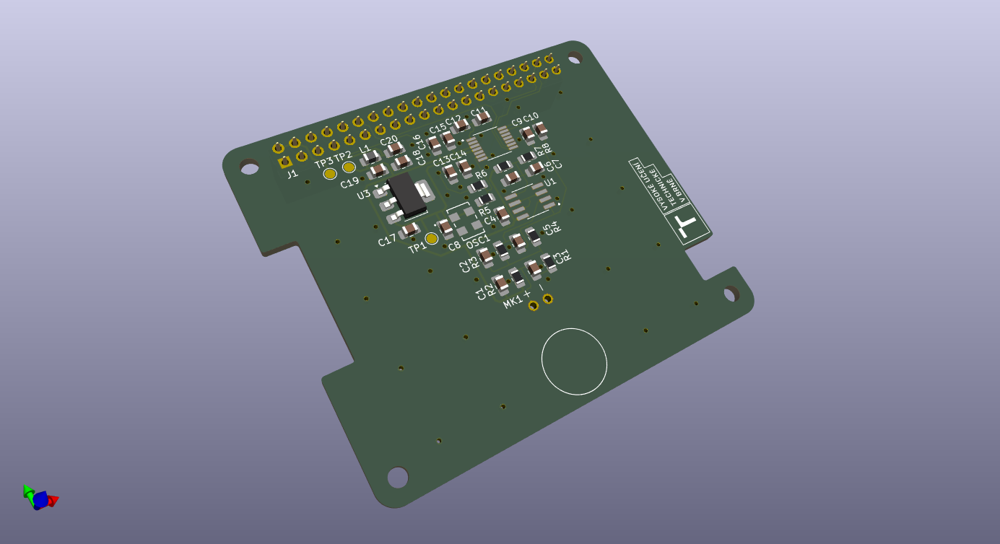

# Autonomous Event-Based Audio Recording System (Raspberry Pi 5 HAT)

Bakalárska práca – FEKT VUT v Brne (Ústav telekomunikácií, odbor Audio inžinierstvo)  
Autor: Bc. Lukáš Hrobák

Kompletný text práce v PDF: [Bakalarska_praca_Hrobak.pdf](./Bakalarska_praca_Hrobak.pdf)

## Popis projektu

Cieľom projektu bol návrh a realizácia hardvérového rozširujúceho modulu (PCB HAT) pre platformu Raspberry Pi 5 a obslužného softvéru pre autonómny, udalosťami riadený (event-based) záznam zvuku v teréne.

Systém priebežne spracováva vstupný audio signál a ukladá záznam iba pri prekročení definovaných parametrov akustickej udalosti, čím šetrí úložisko a zefektívňuje následnú analýzu dát pri dlhodobom monitorovaní.

## Hardvérová časť (PCB HAT)

Vývoj hardvéru prebiehal v dvoch iteráciách:

* **1. revízia (Autodesk Eagle – fyzický prototyp):** Prvotný návrh schémy a plošného spoja, ktorý bol vyrobený a ručne osadený. Počas oživovania (bring-up) a overovacích meraní boli identifikované chyby v návrhu, ktoré boli na fyzickej doske opravené. Na tomto plne funkčnom prototype prebiehal vývoj softvéru a reálne testovanie celého záznamníka.
* **2. revízia (KiCad – redizajn):** Na základe poznatkov a chýb odhalených pri oživovaní prvej verzie bola schéma aj plošný spoj kompletne prepracované v programe KiCad. Táto revízia odstraňuje hardvérové nedostatky prvého prototypu (výstupom návrhu sú výrobné dáta a 3D model dosky).

## Softvérová časť

* Udalosťami riadené (event-based) spúšťanie a ukončovanie audio záznamu v prostredí Linux na Raspberry Pi 5.
* Autonómna prevádzka pri dlhodobom nasadení v teréne a správa zaznamenaných súborov.

## Ukážky hardvéru a návrhu

### 1. Redizajn plošného spoja (2. revízia – KiCad 3D vizualizácia)

### 2. Schéma zapojenia
